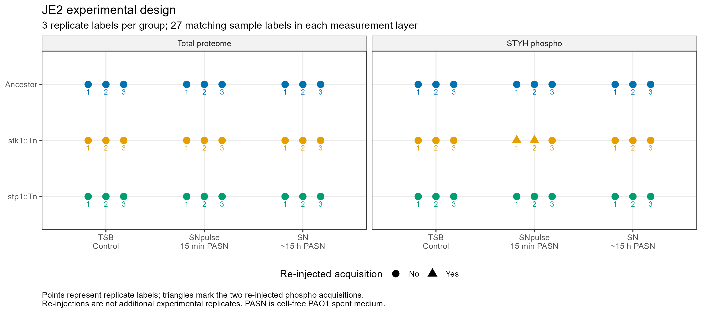

# Step 1: experimental design and comparison plan

Generated: 2026-11-12 13:23:43 UTC

**Result: 28/28 validation checks passed.**

## Verified design

- 27 unique sample labels in the sample sheet and in each measurement layer.
- 3 genotypes (anc, stk, stp), 3 media (TSB, SNpulse, SN), 3 replicate labels per group.
- TSB: control; SNpulse: 15-minute PASN exposure; SN: approximately 15-hour PASN exposure.
- PASN is 30% cell-free, sterile-filtered PAO1 spent medium; this is not a live co-culture.
- 9 shortened Excel sample labels map back to their canonical JE2 sample labels.
- Total layer: no reinjection flags. Phospho layer: JE2stk_pulseSN_1 and _2 flagged.
- These flags do not increase the replicate count. Matching replicate numbers do not establish pairing.



## Dataset inventory before contaminant filtering

| Layer | Abundance features | DEA features | Abundance-only | Samples | Contrasts |
|---|---:|---:|---:|---:|---:|
| total | 2348 | 2324 | 24 | 27 | 33 |
| phospho_STYH | 4278 | 4235 | 43 | 27 | 33 |

Abundance and DEA feature counts differ. The omitted identities are saved locally; Step 1 does not infer why they were omitted.
A complete feature-by-sample row grid includes missing (NA) values and does not mean every feature was detected.

## Direction and planned comparisons

`A_vs_B` means `log2(A) - log2(B)`. Negative `TSB_vs_SN` means higher in SN.
Interaction: `(stk_TSB - anc_TSB) - (stk_SN - anc_SN)` for the kinase-versus-ancestor TSB-versus-SN contrast.
The stp version follows the same formula with stp in place of stk. These are differences between group means, not paired-sample subtractions.

| Contrast | Priority | Question |
|---|---|---|
| `TSB_vs_SN_at_anc` | core | Long PASN response in the ancestor |
| `TSB_vs_SN_at_stk` | core | Long PASN response in the kinase mutant |
| `TSB_vs_SN_at_stp` | core | Long PASN response in the phosphatase mutant |
| `stk_vs_anc_at_TSB` | core | Kinase mutant effect in control medium; first Venn |
| `stp_vs_anc_at_TSB` | core | Phosphatase mutant effect in control medium; first Venn |
| `stk_vs_anc_at_SN` | core | Kinase mutant effect during long PASN exposure; second Venn |
| `stp_vs_anc_at_SN` | core | Phosphatase mutant effect during long PASN exposure; second Venn |
| `interaction_stk_vs_anc_at_TSB_vs_SN` | core | Does the kinase mutant differ in its PASN response? |
| `interaction_stp_vs_anc_at_TSB_vs_SN` | core | Does the phosphatase mutant differ in its PASN response? |
| `interaction_stp_vs_stk_at_TSB_vs_SN` | follow_up | Do the two mutants differ in their PASN response? |
| `TSB_vs_SNpulse_at_anc` | optional | Early 15-minute PASN response in the ancestor |
| `SNpulse_vs_SN_at_anc` | optional | Early versus long PASN exposure in the ancestor |

Full coefficient tables and interpretation text are in the local results/step01 directory.
Pooled contrasts are inventoried but not assigned an unverified weighting formula.

## What remains for Step 2

Check actual detection, missingness, replicate agreement/PCA, and Stk1/Stp1 measurements. Correct metadata do not establish good measurement quality.
The course design notes reduced Stk1 in the stp strain; verify per-sample values before interpreting mutant effects.
No hit selection, enrichment, site-protein adjustment, Venn diagram or motif analysis was run in Step 1.

## Reproduce

```r
source("scripts/01_data/01_validate_design.R")
```

See step01_inputs.md for input hashes and step01_session.txt for package versions.
