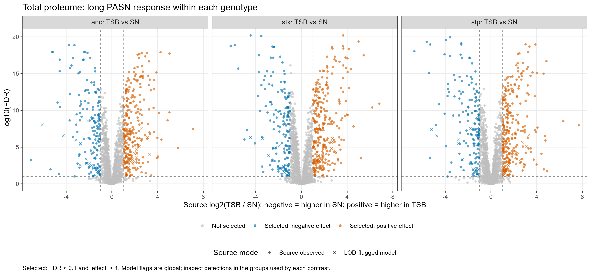
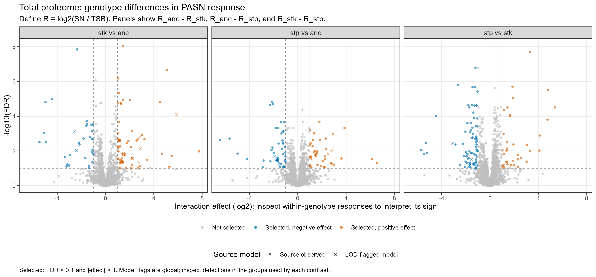
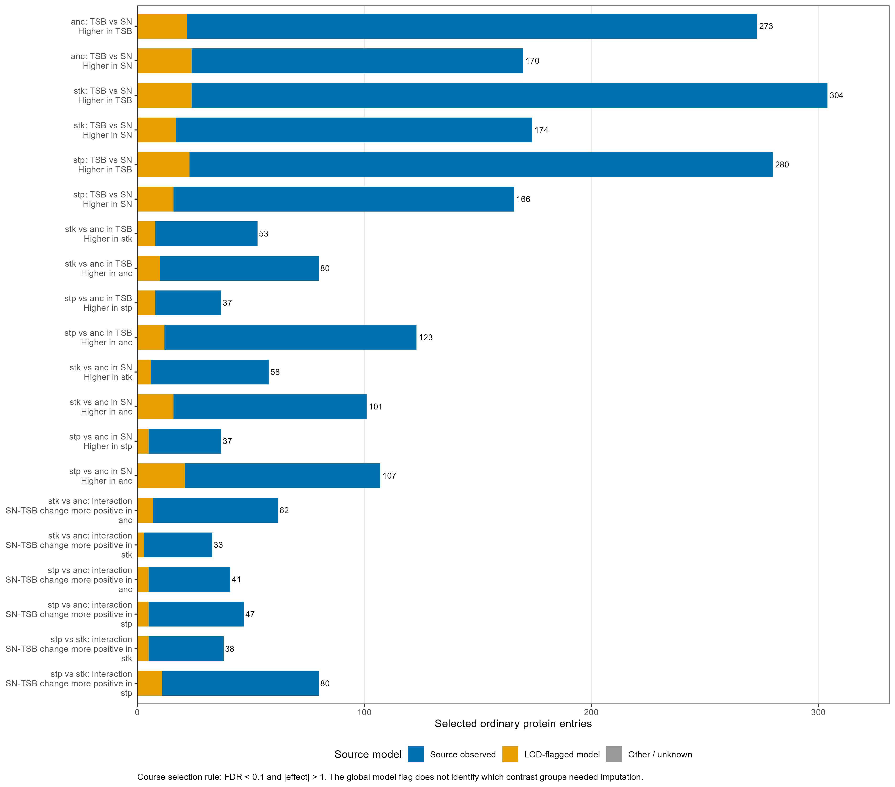
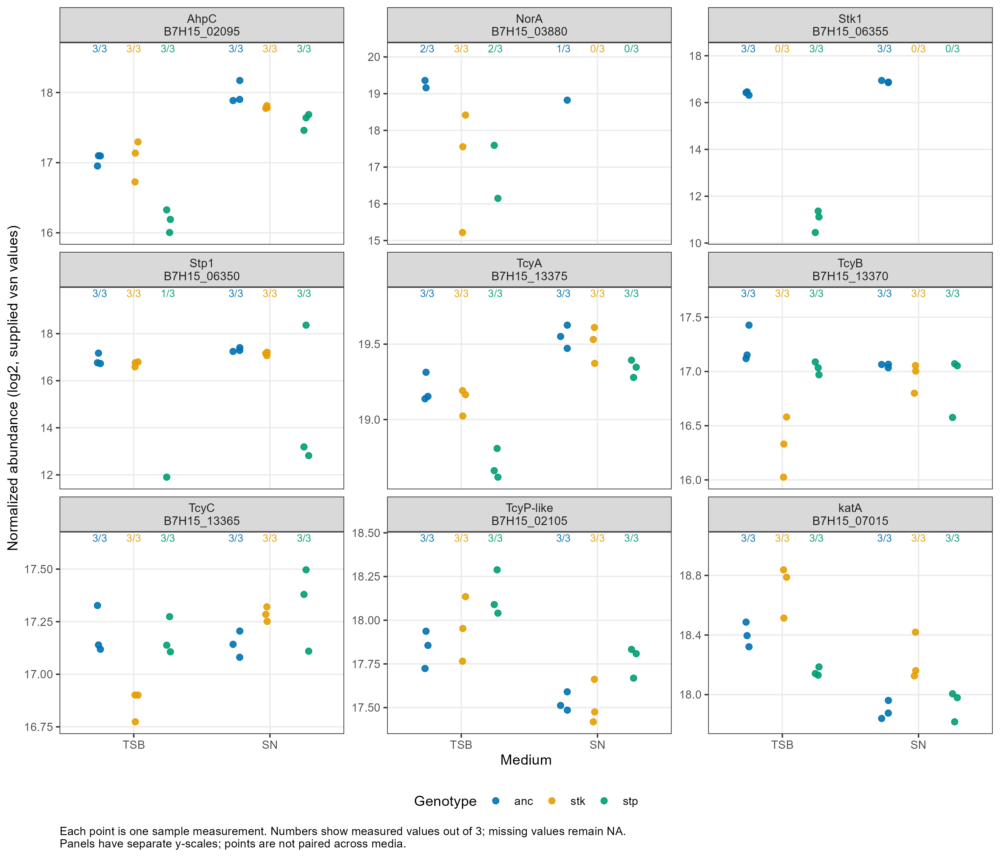

# Step 4: annotated comparisons and total-proteome figures

Generated: 2026-11-12 13:28:13 UTC

20/20 actual-input checks passed across the two layers.

The supplied DEA was annotated, not refitted. Source diff, p-values and FDR are preserved. Step 2 remains skipped at the user's request.

## Total-proteome selection

Ordinary protein entries use metadata entry_class == cds. Selected means source FDR < 0.1 AND |source diff| > 1.
Conservative selected means the same source selection, an observed source-model label, and >=2/3 measured values in every relevant group.

| Contrast | Ordinary protein entries | Selected | Conservative selected |
|---|---:|---:|---:|
| TSB_vs_SN_at_anc | 2229 | 443 | 378 |
| TSB_vs_SN_at_stk | 2229 | 478 | 402 |
| TSB_vs_SN_at_stp | 2229 | 446 | 391 |
| interaction_stk_vs_anc_at_TSB_vs_SN | 2229 |  95 |  67 |
| interaction_stp_vs_anc_at_TSB_vs_SN | 2229 |  88 |  63 |
| interaction_stp_vs_stk_at_TSB_vs_SN | 2229 | 118 |  86 |
| stk_vs_anc_at_SN | 2229 | 159 | 110 |
| stk_vs_anc_at_TSB | 2229 | 133 | 108 |
| stp_vs_anc_at_SN | 2229 | 144 | 102 |
| stp_vs_anc_at_TSB | 2229 | 160 | 131 |

These are protein entries in the JE2 measurement space, not deduplicated UniProt IDs. FDRs were not recalculated after class filtering or across contrasts.

## Read the directions

Negative TSB_vs_SN = higher in SN. Positive TSB_vs_SN = higher in TSB.
Define R_g = log2(SN_g) - log2(TSB_g). The three interactions are R_anc-R_stk, R_anc-R_stp and R_stk-R_stp.
A positive interaction means the reference genotype has a more positive SN-TSB change; it does not simply mean higher abundance in that genotype.
The third interaction effect equals the second minus the first. Its p-value, FDR and standard error are separate source results.

## Source model flags versus actual measurements

In the ancestor TSB-vs-SN ordinary-protein table, 25 LOD-flagged entries nevertheless have 3/3 measurements in both relevant groups.
The source label is global/model-wide in this export. Use group_detection_pattern, n_observed_min_relevant and any_relevant_group_unobserved to examine each comparison.
Do not call every LOD-flagged result a presence/absence effect in the displayed groups. Conversely an observed model label does not guarantee dense replicate support.

## Figures









The predefined candidates are the editable Step 3 list, not a list chosen to maximize significance. Figure 6, when present, shows the lowest-FDR conservative selected entry per interaction, with effect size and key as tie-breakers. These examples are illustrative and not literature-validated biological priorities.

## Preliminary phosphosite tables

The same ten contrasts have annotated site-level tables. The counts below are sites whose parent is an ordinary CDS, not counts of proteins.
These source selections are provisional. No localization threshold or parent-protein adjustment has been applied; those are Step 7. Do not use these as final regulated phosphosite lists or sequence-logo inputs.

| Contrast | CDS-parent site rows | Preliminary selected | Conservative source/support subset |
|---|---:|---:|---:|
| TSB_vs_SN_at_anc | 4100 | 111 | 24 |
| TSB_vs_SN_at_stk | 4100 | 123 | 38 |
| TSB_vs_SN_at_stp | 4100 | 170 | 30 |
| interaction_stk_vs_anc_at_TSB_vs_SN | 4100 |  17 |  1 |
| interaction_stp_vs_anc_at_TSB_vs_SN | 4100 |  43 |  1 |
| interaction_stp_vs_stk_at_TSB_vs_SN | 4100 |  56 |  2 |
| stk_vs_anc_at_SN | 4100 |  42 |  7 |
| stk_vs_anc_at_TSB | 4100 |  60 |  5 |
| stp_vs_anc_at_SN | 4100 |  60 |  8 |
| stp_vs_anc_at_TSB | 4100 |  72 |  6 |

## Use the tables in RStudio

```r
source(if (file.exists("Sarya_George.Rproj")) "R/setup.R" else "Sarya_George/R/setup.R")
ancestor <- read_comparison("TSB_vs_SN_at_anc")
hits <- read_comparison("interaction_stk_vs_anc_at_TSB_vs_SN", hits_only = TRUE)
View(hits)
```

Full per-contrast tables, directional lists, conservative subsets and exclusions are under results/step04. The explanatory guide is docs/step04_interpretation.md.

## Limits and next step

These data compare responses to cell-free mixed spent medium. The documented Stk1 reduction in stp complicates pure phosphatase-loss interpretations.
No pathway enrichment, network-module inference, final phosphosite regulation, Venn or motif analysis was performed here. Next is Step 5 functional enrichment using the annotated ordinary-protein tables and appropriate measured backgrounds.
