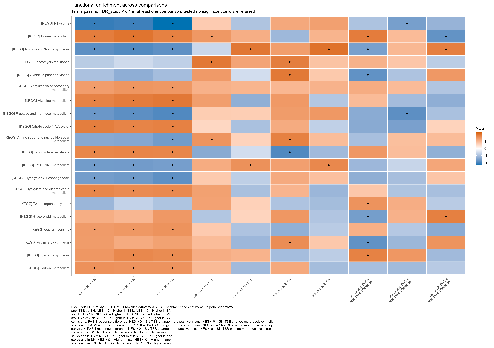
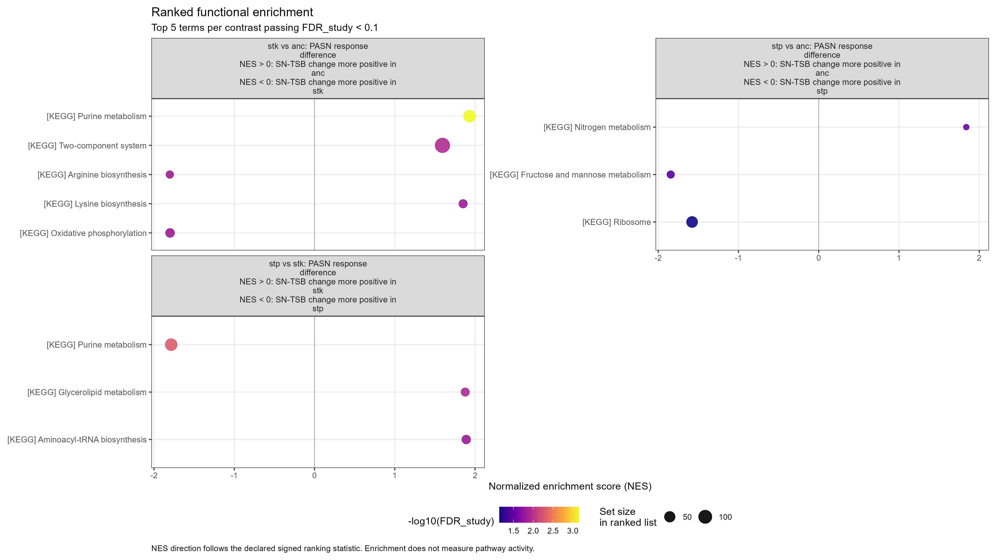
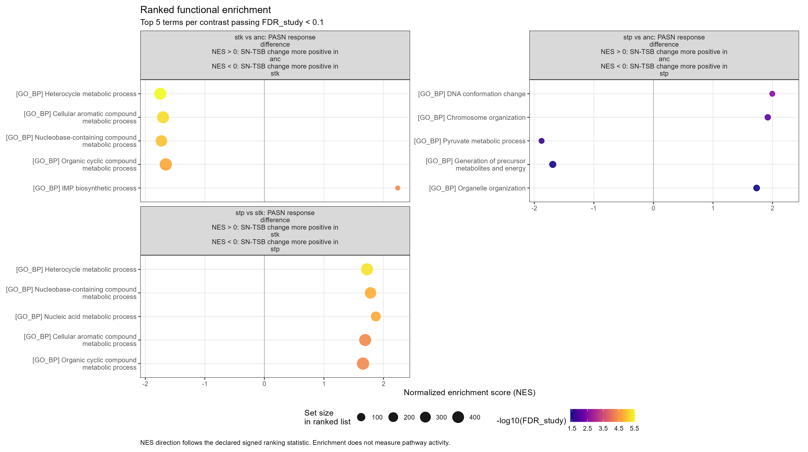
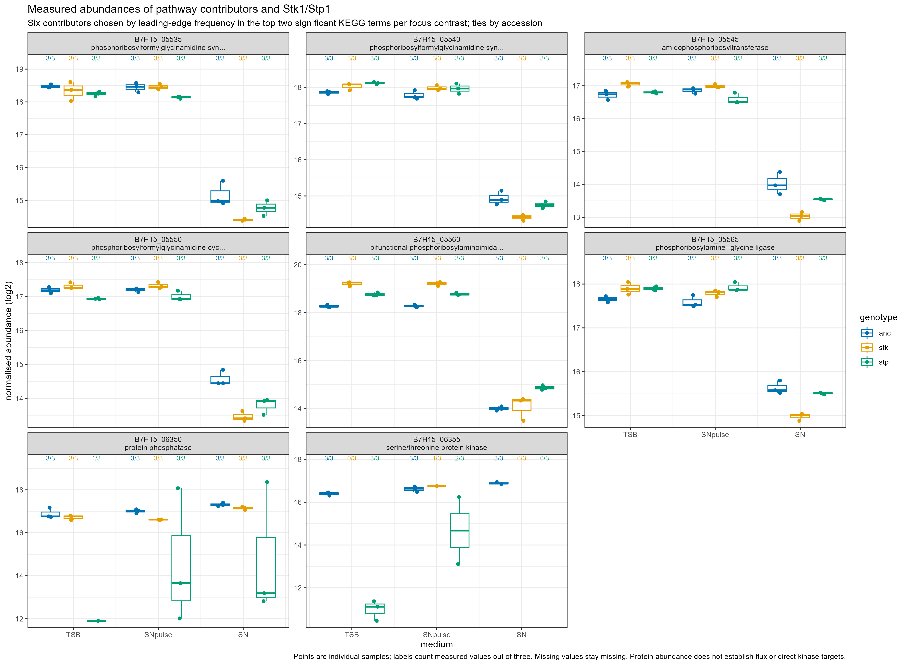
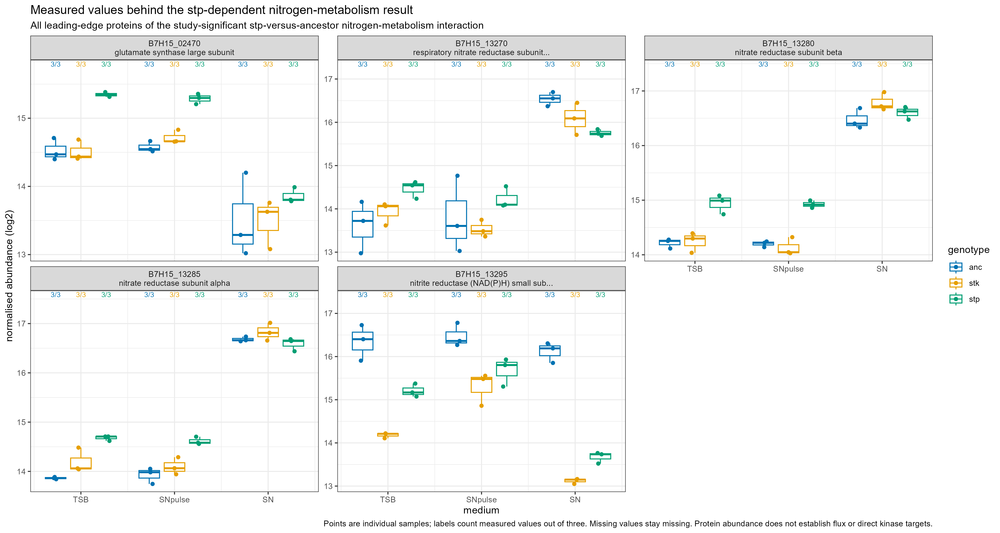

# Step 5: October total-proteome functional enrichment

Generated 2026-11-12 15:33 CET from the saved October comparisons.

ORA and GSEA are complete for ten comparisons, with three separately labelled sensitivity policies. The source protein effects/FDRs were preserved. These analyses identify concentrations of protein abundance changes in functional categories; they do not directly measure pathway activity or phosphorylation.

## How many tests and findings?

| method | tests | significant_term_comparisons |
| --- | --- | --- |
| GSEA | 8180 | 1641 |
| ORA | 16360 | 186 |

Counts are term-comparison results, not independent pathways: GO categories and KEGG maps overlap. Main significance is study-wide BH FDR <0.1, separately for ORA and GSEA across all ten comparisons and five collections. Sensitivity policies have their own correction families.

## Your ancestor response and three interactions

| contrast_label | method | GO_BP | GO_CC | GO_MF | KEGG | UniProt_keywords |
| --- | --- | --- | --- | --- | --- | --- |
| anc: TSB vs SN | GSEA | 101 | 7 | 21 | 17 | 15 |
| anc: TSB vs SN | ORA | 32 | 1 | 4 | 2 | 6 |
| stk vs anc: PASN response difference | GSEA | 91 | 1 | 12 | 9 | 12 |
| stk vs anc: PASN response difference | ORA | 6 | 0 | 0 | 2 | 2 |
| stp vs anc: PASN response difference | GSEA | 40 | 11 | 34 | 3 | 18 |
| stp vs anc: PASN response difference | ORA | 0 | 1 | 0 | 0 | 4 |
| stp vs stk: PASN response difference | GSEA | 84 | 4 | 37 | 3 | 19 |
| stp vs stk: PASN response difference | ORA | 0 | 1 | 0 | 0 | 7 |

### Leading KEGG findings

| contrast_label | term_description | NES | FDR_study | direction | significant_same_sign_all |
| --- | --- | --- | --- | --- | --- |
| anc: TSB vs SN | Ribosome | -2.16 | 1.16e-05 | Higher in SN | TRUE |
| anc: TSB vs SN | Purine metabolism | 1.92 | 3.48e-04 | Higher in TSB | TRUE |
| anc: TSB vs SN | Citrate cycle (TCA cycle) | 1.91 | 4.59e-03 | Higher in TSB | TRUE |
| anc: TSB vs SN | Aminoacyl-tRNA biosynthesis | -1.84 | 8.04e-03 | Higher in SN | TRUE |
| anc: TSB vs SN | Histidine metabolism | 1.83 | 8.28e-03 | Higher in TSB | NA |
| stk vs anc: PASN response difference | Purine metabolism | 1.93 | 6.96e-04 | SN-TSB change more positive in anc | TRUE |
| stk vs anc: PASN response difference | Two-component system | 1.59 | 1.11e-02 | SN-TSB change more positive in anc | TRUE |
| stk vs anc: PASN response difference | Arginine biosynthesis | -1.80 | 1.49e-02 | SN-TSB change more positive in stk | TRUE |
| stk vs anc: PASN response difference | Lysine biosynthesis | 1.85 | 1.52e-02 | SN-TSB change more positive in anc | TRUE |
| stk vs anc: PASN response difference | Oxidative phosphorylation | -1.80 | 1.56e-02 | SN-TSB change more positive in stk | TRUE |
| stp vs anc: PASN response difference | Nitrogen metabolism | 1.84 | 2.57e-02 | SN-TSB change more positive in anc | TRUE |
| stp vs anc: PASN response difference | Fructose and mannose metabolism | -1.84 | 3.43e-02 | SN-TSB change more positive in stp | TRUE |
| stp vs anc: PASN response difference | Ribosome | -1.58 | 7.17e-02 | SN-TSB change more positive in stp | TRUE |
| stp vs stk: PASN response difference | Purine metabolism | -1.79 | 5.12e-03 | SN-TSB change more positive in stp | TRUE |
| stp vs stk: PASN response difference | Glycerolipid metabolism | 1.88 | 1.19e-02 | SN-TSB change more positive in stk | TRUE |
| stp vs stk: PASN response difference | Aminoacyl-tRNA biosynthesis | 1.89 | 1.56e-02 | SN-TSB change more positive in stk | TRUE |

The table displays the five lowest study FDRs per focus comparison. `significant_same_sign_all` means the term remains significant with the same NES direction in all three sensitivity policies. A false value does not automatically invalidate a result; inspect the exact sensitivity values and changed background sizes. NA means a corresponding sensitivity test/result is unavailable, not a negative result.

### Check sensitivity before naming a module

| contrast_label | primary_significant | replicated_significant | observed_replicated_significant | local_JE2_significant | significant_same_sign_all |
| --- | --- | --- | --- | --- | --- |
| anc: TSB vs SN | 161 | 151 | 150 | 143 | 133 |
| stk vs anc in SN | 172 | 166 | 162 | 150 | 145 |
| stk vs anc in TSB | 119 | 102 | 105 | 109 | 93 |
| stk vs anc: PASN response difference | 125 | 107 | 91 | 113 | 85 |
| stk: TSB vs SN | 184 | 171 | 169 | 172 | 160 |
| stp vs anc in SN | 233 | 214 | 203 | 215 | 189 |
| stp vs anc in TSB | 218 | 212 | 200 | 207 | 194 |
| stp vs anc: PASN response difference | 106 | 98 | 95 | 86 | 79 |
| stp vs stk: PASN response difference | 147 | 139 | 136 | 137 | 129 |
| stp: TSB vs SN | 176 | 161 | 165 | 166 | 153 |

`replicated` requires at least 2/3 measurements in every relevant group; `observed_replicated` also requires the source model's observed label; `local_JE2` restores eligible entries excluded by reference mapping. Loss of significance can reflect changed evidence, power, term membership or the background; it is not proof of biological absence.

## The annotation coverage behind the tests

| collection | annotated_proteins | background_size | coverage_fraction | terms_tested |
| --- | --- | --- | --- | --- |
| KEGG | 1405 | 2058 | 0.683 | 74 |
| GO_BP | 1709 | 2058 | 0.830 | 433 |
| GO_MF | 1725 | 2058 | 0.838 | 179 |
| GO_CC | 1800 | 2058 | 0.875 | 38 |
| UniProt_keywords | 1951 | 2058 | 0.948 | 94 |

This is the primary ancestor universe. The complete annotation_coverage.tsv contains each comparison/policy. The common tested-protein background includes proteins without an annotation in a collection; coverage makes this choice visible. Gene sets are intersected with that background before applying the 10-500 member size filter. Interpret broad map names through their contributing proteins, rather than assuming every named process occurs in JE2.

## What was done, in order

1. Read the existing October Step 4 total-proteome table and the Step 3 identifier map/term snapshot. Do not refit source models or replace protein-level FDRs.
2. Remove non-CDS entries and require finite source statistics. For the primary analysis retain high-quality singleton JE2-to-UniProt mappings, so one target accession is counted once. Keep an exclusion audit.
3. Transfer supplied STRING-v12 KEGG, GO BP/MF/CC and UniProt-keyword memberships through those mappings. Deduplicate member-term pairs. Freeze this snapshot and hash its inputs.
4. Define each comparison's entire eligible tested-protein background. Create separate positive/negative ORA lists using source FDR <0.1 and absolute log2 effect >1. Test every eligible term, including zero overlaps, with the upper-tail hypergeometric test.
5. Rank all eligible proteins by the signed source DEA statistic. Run fgseaMultilevel with the declared seeds and serial backend; keep ES, NES, p-value, estimation uncertainty, warnings and leading-edge proteins. The ranking is not restricted to significant proteins.
6. Correct enrichment p-values using the declared local and study-wide BH families. ORA includes both directions in each family; it is adjusted separately from GSEA. The engine's original adjusted values remain separately available.
7. Repeat with the replicated, observed_replicated and local_JE2 policies, always changing foreground, rank vector and background together. Compare each primary finding with its corresponding sensitivity results.
8. Export full pathway tables, directional overlaps, leading edges, sensitivity comparisons and candidate contributors. Plot KEGG/GO findings and NES heatmaps with explicit comparison directions.
9. Query small public-ID lists through the existing UniProt, KEGG and STRING clients for interpretation. Check reference STRING matches against UniProt cross-references. Keep live lookups separate from frozen memberships. Plot measured sample values for selected contributors before interpreting individual proteins.
10. Save the scripts, methods, source hashes, run warnings, package versions, figures and a dated lab notebook entry. Raw inputs and full local caches are not committed.

## Public-resource checks

8 UniProt entries were queried; 8 returned without lookup errors. 6 KEGG maps were retrieved. 8 STRING reference IDs were verified against UniProt cross-references. The small functional network provides context; it is not independent proof of direct targets.

See [lookup policy](resource_checks.md), [UniProt entries](live_uniprot_checks.tsv), [STRING mapping review](live_string_mapping_review.tsv), [STRING functional associations](live_string_context_edges.tsv) and [KEGG map checks](live_kegg_pathway_checks.tsv). The API scripts preserve dated responses in local caches. Public service annotations can differ from the frozen course snapshot.

## Read the direction correctly

For TSB_vs_SN, positive NES concentrates toward higher TSB protein values; negative NES toward higher SN values. For interactions define R_g = log2(SN_g)-log2(TSB_g). Then stk_vs_anc is R_anc-R_stk, stp_vs_anc is R_anc-R_stp, and stp_vs_stk is R_stk-R_stp. More positive can mean a larger increase or a smaller decrease. Enrichment of an interaction is not a direct test of pathway activation.

## Files to open

- [Biological interpretation](interpretation.md) discusses the strongest modules and the limitations of narrower candidates.
- [Full methods guide](../../docs/step05_methods.md) explains the formulas, policies and interpretation.
- [ORA primary significant table](ora_primary_significant.tsv) gives enrichment factors and contributing hit IDs/names.
- [GSEA primary significant table](gsea_primary_significant.tsv) gives NES, uncertainty and leading edges.
- [ORA/GSEA comparison](primary_method_comparison.tsv) keeps their evidence separate; it does not combine p-values.
- [GSEA sensitivity](gsea_primary_sensitivity.tsv) and [ORA sensitivity](ora_primary_sensitivity.tsv) show exact policy-specific results.
- [Candidate module contributors](candidate_module_contributors.tsv) are follow-up candidates, not proven kinase substrates.
- [KEGG contributing proteins](kegg_contributing_proteins.tsv) connects terms to protein IDs and annotations.
- [Universe/hit counts](universe_and_hit_counts.tsv), [coverage](annotation_coverage.tsv), [warnings](gsea_run_log.tsv), [input hashes](input_hashes.tsv), and [settings](run_settings.txt) retain the audit trail.
- [Completed result checks](result_validation.txt) independently verify correction families, backgrounds, ranks, signs, leading edges and a real ORA result.
- Full local outputs are results/step05/ora_all.tsv.gz and gsea_all.tsv.gz; per-comparison TSVs, exact ranks and caches are in results/step05/contrasts and cache. Open these in RStudio; they remain ignored by Git.

## Figures











## Important limits

The local annotation snapshot is STRING v12 (custom organism STRG0A35SHG); its exact minor release and underlying GO/KEGG dates are not supplied. Slides show a separate STRING12.5 example organism. Live reference-organism lookups are explicitly separate and do not silently refresh memberships.

The supplied observed/LOD label is model-wide; a flagged model may have complete measurements in this particular contrast. Conversely observed does not guarantee all 3/3 values. Missing measurements remain NA. The sample plots and replication sensitivities expose support.

These are protein-abundance analyses with n=3 biological replicates per group. Preranked GSEA does not permute sample labels. Neither ORA nor GSEA proves flux, direct physical binding, phosphorylation dependence or direct Stk1 substrates. The reduced Stk1 abundance in the stp strain complicates pure phosphatase-loss interpretations. The phosphosite/Venn/sequence-logo work follows later after site localization and parent-protein checks.

## RStudio commands

```r
source("run_step.R")
run_project_step("enrichment")
run_project_step("enrichment_figures")
run_project_step("enrichment_resources")  # small public-ID queries; network required
run_project_step("enrichment_report")
View(read_enrichment("GSEA", contrast="interaction_stk_vs_anc_at_TSB_vs_SN", collection="KEGG"))
View(read_enrichment("ORA", significant_only=FALSE))
```

## Method references

- [Official fgsea tutorial](https://bioconductor.org/packages/release/bioc/vignettes/fgsea/inst/doc/fgsea-tutorial.html).
- [R hypergeometric test](https://stat.ethz.ch/R-manual/R-devel/library/stats/html/Hypergeometric.html).
- [R multiple-testing correction](https://stat.ethz.ch/R-manual/R-devel/library/stats/html/p.adjust.html).
- Course 06_web_resources_2026.pdf: resource selection; local memberships and ortholog mapping are the supplied Week 2 snapshot.
