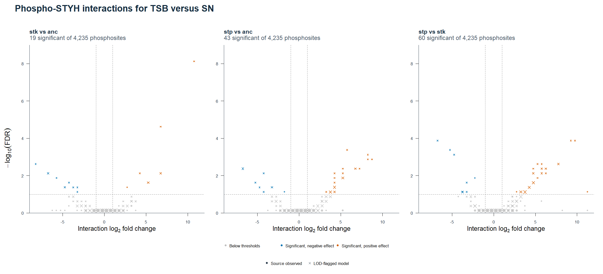

# Step 7 — Phospho-STYH interactions and parent-protein effects

We compared the STYH phosphoproteome with the total proteome for the three genotype-by-medium interactions between TSB and SN. The source data are the `diff_exp_analysis` and `contrasts` worksheets in `data/raw/phospho_STYH/DE_phospho_STYH.xlsx` and `data/raw/total/DE_total.xlsx`.

## Method

We matched phosphosite estimates to the corresponding total-protein estimates by the course's standardized `protein_key` and exact contrast. The key accounts for differences in how the workbooks format the full protein identifiers. The R script reads the course exports in `data/derived/`. Source rows marked as contaminants were outside the comparison. Both DEA tables were evaluated at **FDR < 0.10** and **|log₂FC| > 1**. The directions below refer to the signs of the interaction estimates under the same contrast convention in both workbooks. [Course protein-key definition](../../R/parse.R#L44)

Each contrast had 4,235 testable phosphosite estimates. For 4,149, the corresponding total-protein estimate had a finite effect and FDR. The table summarizes the significant phosphosite estimates. A parent protein can contribute to more than one site, so the counts are site-level.

## Results

| TSB vs SN interaction | Significant phosphosites | Parent significant, same sign | Parent significant, opposite sign | Parent did not meet both thresholds | Parent estimate unavailable |
| --- | ---: | ---: | ---: | ---: | ---: |
| `stk` vs `anc` | 19 | 1 | 0 | 16 | 2 |
| `stp` vs `anc` | 43 | 0 | 1 | 42 | 0 |
| `stp` vs `stk` | 60 | 4 | 0 | 52 | 4 |

The same table is generated by R as [tab-separated values](step07_phospho_parent_counts.tsv).

The third interaction is labeled `interaction_stp_vs_stk_at_TSB_vs_SN` in both workbooks. Reversing the genotype order would reverse both effect signs and preserve their directional agreement.

Most significant site effects were paired with a protein estimate that did not meet both thresholds. This leaves the magnitude of the protein effect uncertain. The original DEA labels 18 of 19, 42 of 43 and 56 of 60 significant phosphosite estimates as LOD-imputed, respectively. In the `stp` versus `stk` interaction, one of the paired protein estimates was also LOD-imputed.

These are comparisons of separately fitted effects. Establishing a phosphorylation change independent of protein abundance requires a protein-adjusted analysis that accounts for uncertainty in both measurements.

## Phospho-STYH volcano plots

The panels show the STYH interaction effect and −log₁₀(FDR) on common axes. Following the Step 4 plotting convention, significant negative effects are blue, significant positive effects are orange, and grey marks estimates below the thresholds. Circles denote source-observed estimates and crosses denote LOD-flagged estimates. Symbols summarize bins of 0.5 log₂ fold change by 0.25 −log₁₀(FDR). Symbol size increases with the number of estimates in the bin. The panel totals come from the original estimates. [Step 4 Volcano reference](https://github.com/SaryaEldeniz/bio253-je2-proteomics/blob/a43d574/Sarya_George/R/figures/step04_plots.R)

## Reproduce

Run `source("Sarya_George/scripts/05_figures/07_render_figures.R")` from the repository root, or `source("scripts/05_figures/07_render_figures.R")` from the group project. Base R generates the table and the figure from the course exports. An independent calculation from the two original Excel workbooks returned the same counts for all three contrasts. [R entry point](../scripts/05_figures/07_render_figures.R) · [Course data description](../../data/README.md) · [DEA thresholds](../../R/constants.R)
