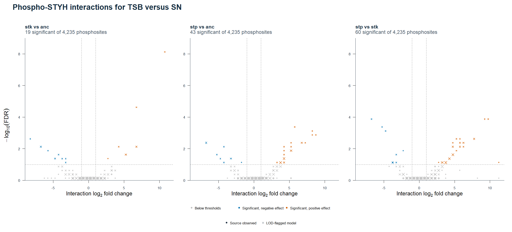
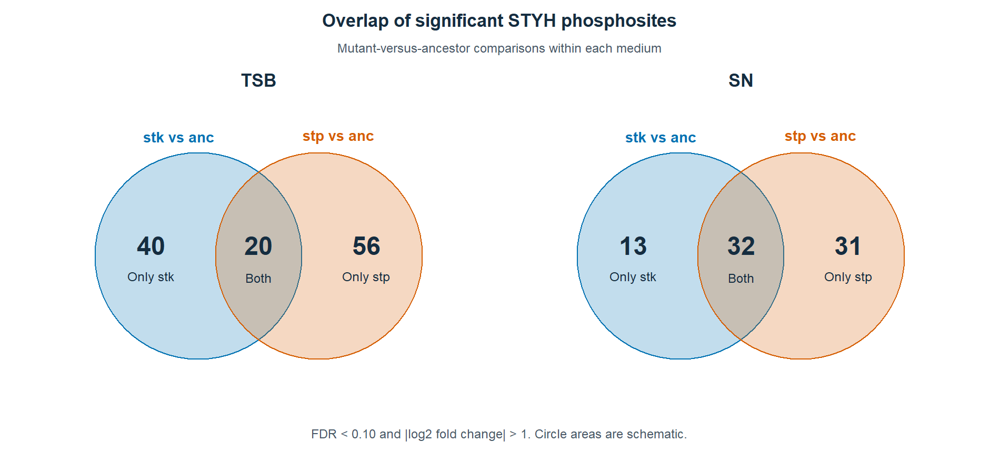
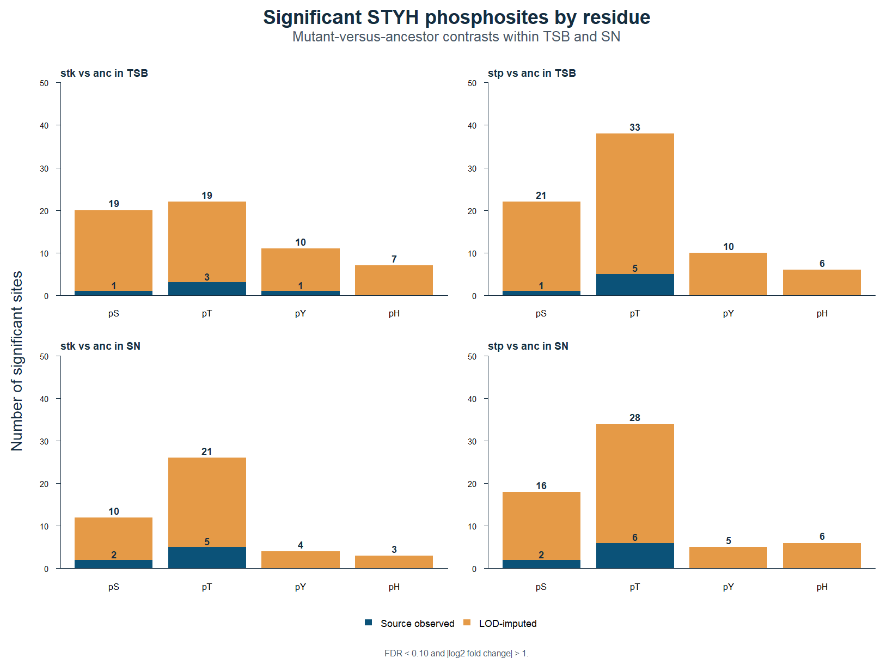
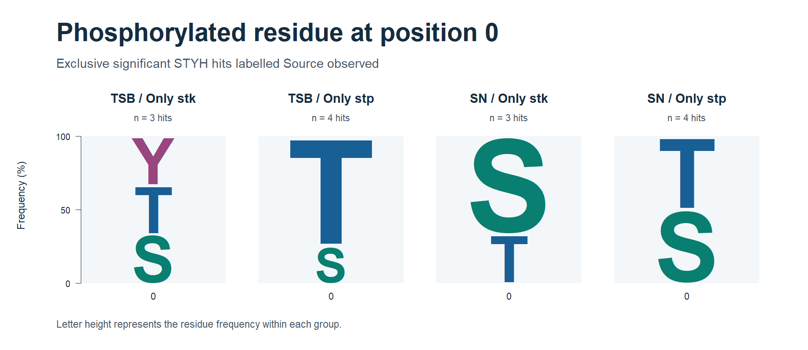

## Research question and hypothesis

How does *Pseudomonas aeruginosa* supernatant (PASN) affect central-metabolism, oxidative-stress and virulence-associated proteins in *Staphylococcus aureus* JE2? Do strains disrupted in `stk1` or `stp1` show different responses, and do the abundance patterns implicate translation-associated functions?

We expected central-metabolism changes, higher abundance of oxidative-stress defense proteins and lower abundance of virulence-associated proteins during PASN exposure. We also expected genotype-dependent responses and considered whether the two mutants show opposing effects.

## Experimental design and analysis

The course design comprised the wild-type ancestor (`anc`) and two transposon mutants (`stk` and `stp`) in TSB, SN and SNpulse, with three biological replicates per group. TSB was the control, SN was approximately 15 h in medium containing PASN, and SNpulse was a 15 min exposure after growth in TSB. PASN was cell-free supernatant. The integrated results below focus on TSB and SN. [Experimental design](https://github.com/SaryaEldeniz/bio253-je2-proteomics/blob/efcb91c438a6b010e0191eeba6b7446c730501fe/Sarya_George/notebook/1_ExperimentalDesign.md)

We used the October total-proteome and STYH differential analyses. Step 4 selected ordinary protein entries (CDS) with source FDR < 0.10 and absolute log₂ effect > 1. Step 5 used over-representation analysis (ORA) of selected hits and gene set enrichment analysis (GSEA) of ranked protein estimates. The enrichment FDRs cited here are the primary study-wide values from Step 5. In `TSB_vs_SN_at_anc`, a positive source effect points toward TSB and a negative effect toward SN. With `R_g = log₂(SN_g / TSB_g)`, the three native interaction effects are `R_anc − R_stk`, `R_anc − R_stp` and `R_stk − R_stp`. [Step 4 comparisons](https://github.com/SaryaEldeniz/bio253-je2-proteomics/blob/efcb91c438a6b010e0191eeba6b7446c730501fe/Sarya_George/reports/step04_comparisons.md) · [Step 5 methods](https://github.com/SaryaEldeniz/bio253-je2-proteomics/blob/efcb91c438a6b010e0191eeba6b7446c730501fe/Sarya_George/docs/step05_methods.md)

Step 7 matched phosphosite and parent-protein estimates in the same interaction and applied FDR < 0.10 and absolute log₂ effect > 1 to each layer. Steps 8 and 9 used four direct mutant-versus-ancestor comparisons within the two media with the same STYH hit criteria. The overall Venn diagrams and residue counts included both source estimate types. The residue-specific Venn diagrams and position-0 logo used hits labelled `observed` in the supplied analysis that met the selection criteria in only one mutant contrast within a medium. [Step 7](step07_phospho_parent_comparison.md) · [Step 8](../notebook/2026-11-12_step08.md) · [Step 9](../notebook/2026-11-13_step09.md)

## Results

### Wild-type protein abundance during long exposure

In Step 4, 443 of 2,229 CDS protein entries met the selection criteria in the wild-type TSB-versus-SN comparison. Ranked enrichment showed several distinct abundance patterns. [Step 4 comparisons](https://github.com/SaryaEldeniz/bio253-je2-proteomics/blob/efcb91c438a6b010e0191eeba6b7446c730501fe/Sarya_George/reports/step04_comparisons.md)

| Term | NES | Study FDR | Enriched toward |
| --- | ---: | ---: | --- |
| Citrate cycle (TCA cycle) | +1.91 | 0.00459 | TSB |
| Purine metabolism | +1.92 | 0.000348 | TSB |
| Response to oxidative stress (GO:0006979) | −1.69 | 0.0815 | SN |
| Ribosome | −2.16 | 0.0000116 | SN |
| Aminoacyl-tRNA biosynthesis | −1.84 | 0.00804 | SN |

The metabolic and translation-associated categories show distinct directions. The oxidative-stress result supports the predicted direction at the specified threshold. A general decrease in virulence-associated proteins remains open in the reviewed functional summaries. [Step 5 primary GSEA](https://github.com/SaryaEldeniz/bio253-je2-proteomics/blob/efcb91c438a6b010e0191eeba6b7446c730501fe/Sarya_George/reports/step05/gsea_primary_significant.tsv)

### Genotype-dependent responses

The purine-metabolism category was enriched toward TSB in the ancestor and both mutants. The `stk` versus `anc` interaction was positive (NES +1.93, study FDR 0.000696), consistent with a more negative SN-minus-TSB abundance response in `stk`. Nitrogen metabolism showed a more positive response in `anc` than in `stp` (NES +1.84, study FDR 0.0257). These category-level results describe different abundance responses in the two strain comparisons. [Step 5 interpretation](https://github.com/SaryaEldeniz/bio253-je2-proteomics/blob/efcb91c438a6b010e0191eeba6b7446c730501fe/Sarya_George/reports/step05/interpretation.md)

### Phosphosite effects and corresponding proteins

| TSB vs SN interaction | Significant sites | Parent significant, same sign | Parent significant, opposite sign | Parent below combined criteria | Parent estimate unavailable | Site estimate LOD-imputed |
| --- | ---: | ---: | ---: | ---: | ---: | ---: |
| `stk` vs `anc` | 19 | 1 | 0 | 16 | 2 | 18 |
| `stp` vs `anc` | 43 | 0 | 1 | 42 | 0 | 42 |
| `stp` vs `stk` | 60 | 4 | 0 | 52 | 4 | 56 |

{width=100%}

The parent-protein categories compare separately fitted effects. A protein estimate below the combined cutoffs leaves its contribution to the site effect uncertain. Inferring a phosphorylation effect adjusted for protein abundance would require a model that propagates uncertainty from both measurements. [Step 7 results](step07_phospho_parent_comparison.md) · [Kohler et al., 2023](https://doi.org/10.1016/j.mcpro.2022.100477)

### Overlap and residue distribution

In TSB, 40 significant hits were exclusive to the `stk` comparison, 20 were shared and 56 were exclusive to the `stp` comparison. The corresponding counts in SN were 13, 32 and 31. Of the shared hits, 18 of 20 in TSB and 31 of 32 in SN had the same effect sign relative to `anc`. These are direct comparisons within a medium. The interaction analysis above addresses differences in PASN response across media. [Step 8 counts](step08_phospho_venn_counts.tsv)

{width=100%}

The four direct contrasts yielded 60 and 76 hits in TSB and 45 and 63 in SN for the `stk` and `stp` comparisons, respectively. Across both estimate types, phosphothreonine accounted for the most hits by count in all four contrasts. Every significant phosphohistidine estimate carried the LOD-imputed flag. [Step 9 counts](step09_phospho_residue_counts.tsv)

{width=100%}

The exclusive `Source observed` sets contained 3 hits for `stk` and 4 for `stp` in each medium. Threonine accounted for 3 of 4 hits in the exclusive `stp` set in TSB. Serine accounted for 2 of 3 hits in the exclusive `stk` set in SN. The logo shows the frequency of the phosphorylated residue at position 0. The group sizes support descriptive comparisons. Sequence context and substrate specificity remain undetermined. [Residue-specific Venn diagrams](../figures/step09/figure09_phospho_residue_venn.png) · [Exclusive-hit counts](step09_phospho_residue_venn_counts.tsv)

{width=100%}

## Discussion

The evidence supports changes in the abundance of proteins involved in central metabolism and supports the predicted direction of the oxidative-stress category at the study threshold. The virulence prediction remains open. The ribosome and aminoacyl-tRNA biosynthesis results indicate changes in translation-associated protein abundance. The growth and protein synthesis rates themselves remain undetermined.

The total-proteome and phosphoproteome interactions support genotype-dependent responses. The predominantly same-sign overlap in the direct contrasts limits a simple model of opposing effects. The course notes also report reduced Stk1 abundance in the `stp` strain, which limits attribution of that strain's response to the phosphatase alone. The high proportion of LOD-imputed phosphosite estimates and the use of separately fitted protein effects limit mechanistic interpretation. [Course notes](https://github.com/SaryaEldeniz/bio253-je2-proteomics/blob/efcb91c438a6b010e0191eeba6b7446c730501fe/CLAUDE.md) · [Evidence table](step10_evidence.md)

## References

- Bio253 course dataset and Sarya–George analysis. [Course data description](https://github.com/SaryaEldeniz/bio253-je2-proteomics/blob/efcb91c438a6b010e0191eeba6b7446c730501fe/data/README.md) · [Step 5 enrichment report](https://github.com/SaryaEldeniz/bio253-je2-proteomics/blob/efcb91c438a6b010e0191eeba6b7446c730501fe/Sarya_George/reports/step05/README.md)
- Subramanian et al. (2005). Gene set enrichment analysis. [PNAS](https://doi.org/10.1073/pnas.0506580102)
- Kohler et al. (2023). MSstatsPTM and relative quantification of post-translational modifications. [Molecular & Cellular Proteomics](https://doi.org/10.1016/j.mcpro.2022.100477)
