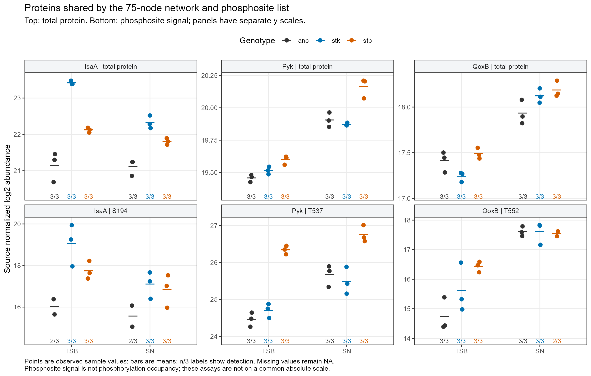

# Protein overlap with the complete75 network: biological interpretation

[New figure: baseline phosphosite differences versus interaction tests](figure_control_vs_interaction.md) shows the individual TSB/SN observations and all nine source interaction estimates with confidence intervals and FDR labels.

Three of the student's12 phosphosite-listed proteins occur in the complete75 STRING network: IsaA(Q2FV52), Pyk(Q2FXM9), QoxB(Q2FZK0). The original49 list contained IsaA/Pyk; the original67 contained QoxB. The remaining nine listed proteins are absent from75. This is a protein-level intersection, not a test of overlap enrichment.

## What the measurements establish

All three total proteins have observed estimates with >=3/3 detections in every relevant group. The three listed phosphosite hits are observed-source mutant-vs-ancestor effects in TSB. They meet the original step9 criteria(FDR<0.1,absolute log2effect>1); they are not sites detected exclusively in those mutants. The other mutant contrast simply did not meet the same joint thresholds. A difference in significance does not establish a significant difference between the mutants.

| Protein | JE2 site | Phosphosite comparison | Site log2 effect | Site FDR | Parent log2 effect | Parent FDR |
| --- | --- | --- | ---: | ---: | ---: | ---: |
| IsaA (Q2FV52) | S194 | stk vs anc, TSB | +3.04 | 0.0157 | +2.27 | 0.000000000662 |
| Pyk (Q2FXM9) | T537 | stp vs anc, TSB | +1.88 | 0.00604 | +0.142 | 0.0144 |
| QoxB (Q2FZK0) | T552 | stp vs anc, TSB | +1.69 | 0.0699 | +0.0746 | 0.53 |

All positive effects in this table mean higher signal/abundance in the indicated mutant than the ancestor in TSB. Values are source estimates; FDRs have not been recalculated. Parent and phosphosite were fitted separately, so subtracting their estimates would not provide a tested phosphorylation-occupancy result.

Crucially, none of these three sites has a significant source phosphosite effect in any of the three TSB-vs-SN genotype interactions(FDR<0.1; nine tests shown, minimum source FDR=0.616). Thus the supported overlap is a mutant-dependent total-protein response to PASN plus a baseline-TSB phosphosite difference on the same protein. It does not demonstrate PASN-dependent phosphorylation at those sites.

The sample plot shows the observed normalized values, six groups only(TSB/SN). Parent proteins have3/3 detections in all groups. IsaA S194 has2/3 ancestor detections in both media; QoxB T552 has2/3 in stp_SN; the other displayed site groups have3/3. No missing value was replaced with zero.



## Pyk: the most useful initial phosphoregulation candidate

Pyk catalyses phosphoenolpyruvate+ADP to pyruvate+ATP, providing glycolytic ATP and pyruvate for subsequent metabolism. P.aeruginosa products can suppress respiration, making glycolysis, fermentation and redox balancing relevant. [Roman-Rodriguez2025](https://journals.asm.org/doi/10.1128/jb.00101-25) directly tested conditioned medium/HQNO, respiration and fermentative survival. This supplies a plausible context, not proof that the Pyk change improves survival in our mixture.

Our Pyk T537 signal is higher in stp than ancestor in TSB(log2+1.88), while parent Pyk is only slightly higher(log2+0.142). That makes a phosphorylation-specific contribution worth testing. In total-protein data Pyk increases under SN in all three genotypes; the increase is modestly greater in stp than stk(interaction stp/stk=-0.210,FDR0.0276,with TSB-minus-SN contrast orientation). Pyk has20 associations in the selected75, including Ndk(score0.925) and AtpD(0.791); these are functional associations, not demonstrated phosphorylation edges.

[Vasu2015](https://link.springer.com/article/10.1007/s13205-014-0248-3) found that PknB-phosphorylated Pyk had lower activity in vitro in another S.aureus strain, but did not identify T537. [Burnside2010,Table6](https://journals.plos.org/plosone/article?id=10.1371/journal.pone.0011071) detected the corresponding Pyk phosphopeptide in both NewmanWT and Delta-stk1. Our JE2 sequence contains ALGLITEENGITSPSAIVGLEK at526-546,with the marked threonine at537. Therefore published evidence supports Pyk phosphoregulation and possible Stk1-independent phosphorylation; it does not establish which enzyme modifies T537 here or its effect on activity.

## QoxB: the closest functional link to respiratory stress

QoxB is subunitI of the QoxABCD terminal quinol oxidase. Although the course product calls it ubiquinol oxidase,S.aureus uses a menaquinol respiratory chain. [Hammer2016](https://journals.asm.org/doi/10.1128/mbio.00823-16) establishes QoxABCD's terminal respiratory function. [Roman-Rodriguez2025](https://journals.asm.org/doi/10.1128/jb.00101-25) shows that HQNO lowers oxygen consumption. These findings make an oxidase response highly relevant to a PA-supernatant experiment; this experiment does not isolate HQNO from the mixture.

Our total QoxB abundance increases under SN in all genotypes; the increase is greater in stk than ancestor(interaction stk/anc=-0.361,FDR0.0666). Increased protein can be a compensatory response to respiratory stress and does not demonstrate higher respiratory activity. In TSB,the QoxB T552 signal is higher in stp than ancestor(log2+1.69),whereas parent protein differs little(log2+0.0746,FDR0.53). This separation makes T552 a useful candidate for protein-adjusted analysis. It does not establish direct Stp1 dephosphorylation or site function.

QoxB has5 associations in the selected75,including QoxA(0.999),AtpA(0.700),AtpG(0.477),Ndk(0.446),AtpD(0.423). This connects the observed protein to the respiratory apparatus. No QoxB-Stk1/Stp1 edge occurs in this selected graph. I found no verified T552-specific functional assay in the sources reviewed.

## IsaA: the clearest envelope/abundance candidate,with more site-level ambiguity

IsaA is a secreted/cell-wall-associated peptidoglycan hydrolase,usually annotated as a putative lytic transglycosylase. [Stapleton2007](https://pmc.ncbi.nlm.nih.gov/articles/PMC2168438/) demonstrated peptidoglycan hydrolysis and identified respiratory-state regulator SrrAB as a positive regulator of isaA under aerated conditions. [Lopes2019](https://pubmed.ncbi.nlm.nih.gov/31570396/) connects isaA deletion to reduced biofilm formation and beta-lactam resistance. This makes envelope remodelling a biologically plausible response,without implying that more IsaA always means more biofilm or resistance.

Our total IsaA falls under SN much more in stk than ancestor(interaction stk/anc=+1.060,FDR0.00660);stk remains higher in absolute abundance than ancestor in both media. Thus a larger decline does not mean stk has the lowest final IsaA amount. The TSB S194 signal is higher in stk than ancestor(log2+3.04),but parent IsaA is also much higher(log2+2.27). Much of the site-signal difference may reflect protein abundance. Cell-associated IsaA abundance also need not equal secreted activity. IsaA is an isolate in the selected75 graph; this does not mean it has no partners generally.

A useful correction to the earlier pathway-review interpretation: [Ma2022](https://pmc.ncbi.nlm.nih.gov/articles/PMC9229027/) found that isaA disruption affected purine-biosynthesis genes and proteins. IsaA is not thereby a purine enzyme,but an indirect envelope-metabolism connection is documented. This is another reason not to exclude it solely because its main function differs from a pathway label.

## Limits that affect prioritisation

- Pyk has consistently high exported localization probabilities(about0.928-0.957) in the displayed TSB/SN runs. IsaA and QoxB vary more; some finite-quantification entries have low localization scores(IsaA includes0;QoxB includes0.480). Their global FragPipe best probabilities are0.896/0.950,respectively. A best site probability does not mean every run independently localized the same residue. Check annotated spectra/localization before attributing function to S194 or T552; a0entry may reflect missing identification/localization metadata and should not be interpreted as biological absence.
- Protein overlap and association-network membership do not establish direct kinase/phosphatase substrates. Higher site signal in stp is compatible with reduced dephosphorylation,but many indirect mechanisms can produce it. Course guidance also notes reduced Stk1 in the stp strain(possible polar effect),so stp is not a clean phosphatase-only perturbation.
- More phosphosite signal is not necessarily a larger fraction of molecules phosphorylated. Protein-adjusted modelling should account for uncertainty in both total and phospho measurements; no occupancy calculation or new formal test was performed here.
- Three overlaps from selected candidate lists are descriptive. No whole-proteome overlap enrichment or improved-survival claim follows.

## Practical next use

Prioritise Pyk for a well-localized phosphosite/protein-adjusted comparison;QoxB for its direct link to respiratory physiology;IsaA for the strong envelope-related total-protein response and the question of secretion/retention. Keep the three claims distinct. The next decisive checks are site-spectrum review,matched parent-protein adjustment,and then functional assays if feasible. Do not present any of these sites as significant PASN phospho interactions on current results.

## Reproduce and inspect

```r
source("steps/06_string_network/scripts/06_compare_phosphosite_overlap.R")
source("steps/06_string_network/scripts/06_write_phosphosite_overlap_report.R")
```

Exact12-protein membership:all12_protein_overlap.csv. Verified14site hits:all14_site_hits_checked.csv. Three hit/parent comparisons:three_overlapping_sites_and_parent_TSB.csv. All9site interactions:three_sites_PASN_interaction_estimates.csv. Source protein responses:three_protein_SN_responses.csv. JE2 sequence checks:JE2_site_coordinate_checks.csv. Localization summaries and network edges are saved separately. literature_evidence.csv records primary references and their limits. No source DEA,existing STRING figure,or historical ORA/GSEA was changed.
